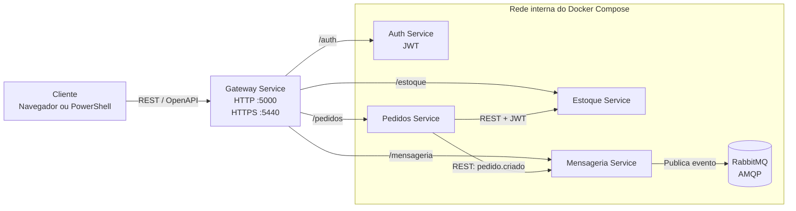

# Arquitetura da solução

O Gateway é a única aplicação com porta publicada no computador host. Os
demais serviços são acessados pelo nome do container dentro da rede
`vinheria`, que funciona como DNS interno do Compose.

O fluxo de compra é:

1. O cliente acessa apenas o Gateway.
2. O cliente cadastra-se ou obtém um JWT em `/auth/v1/auth`.
3. O Gateway encaminha a chamada para `/pedidos` ou `/estoque`.
4. Pedidos valida o JWT, encaminha o token e chama Estoque por REST interno.
5. Pedidos chama Mensageria, que publica `pedido.criado` no RabbitMQ.
6. O pedido fica `CONFIRMADO` ou `CONFIRMADO_EVENTO_PENDENTE`.

O fluxo HTTP usa OpenAPI/Scalar para documentação e teste manual. A
autenticação usa JWT assinado pelo AuthService; Pedidos e Estoque validam o
mesmo token e exigem a role `user`. A comunicação de eventos usa RabbitMQ
através do Mensageria Service.

## Próximas evoluções

Esta arquitetura pode evoluir gradualmente sem alterar o fluxo demonstrado:

- adicionar um banco persistente para usuários, estoque e pedidos;
- substituir o armazenamento em memória por repositórios e migrations;
- usar hash de senha com algoritmo próprio para credenciais, como Argon2id ou
  bcrypt;
- trocar o emissor local de JWT por Keycloak ou outro provedor OIDC;
- habilitar HTTPS entre o Gateway e os serviços, além do HTTPS externo;
- adicionar retries, timeout, circuit breaker e correlação de requisições;
- incluir observabilidade com logs estruturados, métricas e tracing;
- configurar exchanges, filas e consumidores dedicados para eventos;
- publicar o deploy em um ambiente separado do Jenkins, como um servidor,
  Kubernetes ou Azure Container Apps;
- automatizar testes de integração e testes de contrato no pipeline.
